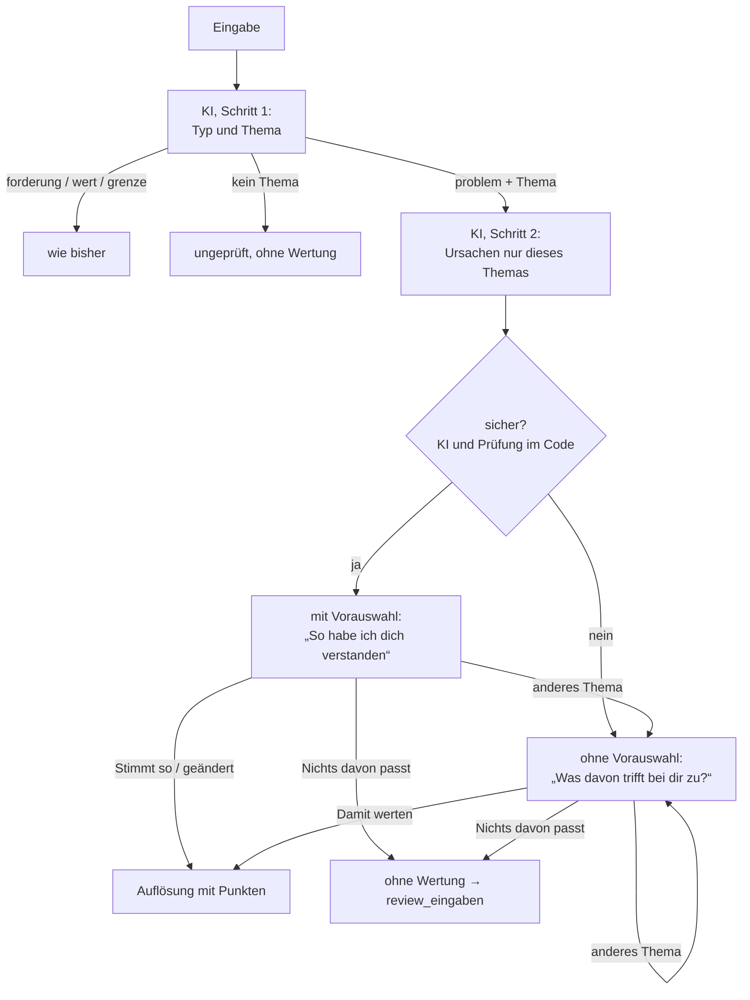

# Plan: Verlässliche Zuordnung – die Person bestätigt jede Wertung

Stand: 13. 10. 2026 · Konzept, noch nicht umgesetzt. Grundsatzentscheidungen getroffen (siehe „Entscheidungen“).

## Ziel

Wer ein persönliches Problem nennt, sieht weiterhin, welche Partei genau dafür am besten abschneidet. Neu ist zweierlei:

1. **Die KI ordnet in zwei engen Schritten zu** – erst das Thema, dann nur unter dessen Ursachen. Das verhindert Sprünge in fremde Themen.
2. **Vor jeder Wertung bestätigt die Person.** Ist die KI sicher, sind ihre Ursachen vorausgewählt und die Person bestätigt oder ändert sie. Ist sie unsicher, wählt die Person selbst aus den Alltagssätzen des Themas, ohne Vorauswahl, 

In beiden Fällen kann sie auch „Nichts davon passt“ sagen.

Grundsatz: **Die KI ist Übersetzerin, die Person hat das letzte Wort.** Gewertet wird nur, was die Person bestätigt hat; wo die KI raten müsste, schlägt sie nichts vor.

## Anlass

Zwei Testpartien in der geschlossenen Testphase (Persona: älterer AfD-Wähler, Rentner; AfD gegen Union mit Sachsen-Anhalt, AfD gegen SPD ohne Land; 12 Eingaben, 10 gewertete Runden). Die Punkte aus der Datenbank waren meist nachvollziehbar, die Fehler lagen fast alle in der Zuordnung:

| Falltyp | Beispiel aus den Partien | Folge |
| --- | --- | --- |
| Beleg passt nicht zur Ursache | „Bus fährt kaum“ als Beleg für „Termine im Gesundheitssystem werden kaum gesteuert“; „Polizei sieht man kaum“ für „Straftaten bleiben unaufgeklärt“; „Formulare verstehe ich nicht“ für „Register nicht vernetzt“ | Punkte für eine Ursache, die die Person nicht genannt hat |
| Falsches Thema | „Schluss mit den Windrädern“ → Auswahl aus *Schule*; die konkrete Antwort („schlafe schlecht“, Strompreis) → Auswahl aus *Hitze und Unwetter*; erst die dritte Eingabe → *Energiepreise* | Die KI ordnet nach Ähnlichkeit mit Ursachentexten, nicht nach dem Thema |
| Keine passende Ursache im Katalog | „Fremd im eigenen Ort, kaum Deutsch auf der Straße“ → nur Ursachen zu Asylverfahren und Arbeitsmarkt; die nächstliegende angetippt, gewertet | Ein anderes Problem wird gewertet als genannt |

Der Prompt regelt diese Fälle schon (`ki.ts` → `systemPrompt`: „Nimm keine Ursache dazu, nur weil sie … ähnlich klingt“), und `bereinigeAntwort` prüft, dass der Beleg wörtlich in der Schilderung steht. **Ob der Beleg die Ursache trägt, lässt sich im Code aber nicht prüfen** – und weitere Regeln im Prompt beheben einzelne Fälle, nicht das Raten selbst. Menschen schildern Symptome („Strom ist teuer“); die Ursachen im Katalog sind Befunde („Börsenpreis richtet sich nach dem teuersten Kraftwerk“). Diese Lücke kann die KI nur schließen, indem sie rät.

## Ausgangsmessung (13. 10. 2026)

`npm run ki:testset -- --nur <die 20 Fälle tp-*, beleg-*, thema-*>` mit dem heutigen Prompt, ein Lauf: **11 von 20 richtig** (Typ 19/20, Thema 17/20, Ursachen exakt 7/13). Die Fehler aus den Testpartien treten wieder auf – sie sind also systematisch, keine Ausreißer:

| Fall | Erwartet | KI heute | Falltyp |
| --- | --- | --- | --- |
| tp-windrad-forderung | Haltung (Windkraft-Ausbau) | Forderung, Thema **Schule** – wie in der Testpartie | falsches Thema |
| tp-windrad-laerm | kein erfasstes Thema | Thema **Internet und Mobilfunk** | falsches Thema |
| thema-tanken-tafel | Armut, Nachfrage | Autofahren, zwei Ursachen | falsches Thema |
| tp-amt, beleg-formular | „so viele Vorschriften und Formulare“ (1404) | beide Male „dieselben Nachweise bei jeder Behörde“ (1403) | Beleg passt nicht |
| tp-bahnhof | nur „nachts an Bahnhöfen unsicher“ (901) | zusätzlich „Straftaten bleiben ohne Folgen“ (902) – wie in der Testpartie | Beleg passt nicht |
| tp-rente-reicht-nicht | keine Ursache (Rentenniveau nicht erfasst) | „kleine Rente, weil wenig verdient“ (702) | nur entfernt passend |
| tp-arzt-land | Nachfrage (zwei Probleme) | zwei Arzt-Ursachen | mehrere Probleme |
| tp-wohnung-warten | Sozialwohnungen (206) | nur die erlaubten Nebenursachen | zu wenig |

Einzelergebnisse liegen nicht im Repository; der Lauf ist mit dem Befehl oben wiederholbar.

## Messung nach Schritt 2 (14. 10. 2026)

Dieselben 20 Fälle, je ein Lauf, mit `ordneEin` (Schritt 1 und 2, wie in der Edge Function):

| | vorher (ein Aufruf) | nachher (zwei Schritte) |
| --- | --- | --- |
| alles richtig | 11/20 | 11/20 |
| falsche Ursachen (falsche statt richtiger) | 2 | **0** |
| zu viele Ursachen | 3 | 3 |
| zu wenige Ursachen | 1 | 3 |
| unnötige Nachfragen | 0 | 0 |
| Thema richtig | 17/20 | 17/20 |
| Token Eingabe je Aufruf | 16.764 | rund 4.500 (Schritt 1) + rund 1.000 (Schritt 2) |

- **Besser:** Keine Ursache wird mehr mit einem unpassenden Beleg gewertet (Formulare → „dieselben Nachweise bei jeder Behörde“ ist weg). Kosten je Einordnung rund ein Drittel.
- **Schlechter:** Die Belegprüfung verwirft auch richtige Nebenursachen, wenn die Wörter nicht übereinstimmen („Personal überlastet“ → „zu wenige Pflegekräfte“). Mit der Bestätigung in der App ist das harmlos: Die Ursache ist dann nur nicht vorausgewählt.
- **Unverändert:** Rente (702 trotz 40 Arbeitsjahren), Bahnhof (902 zusätzlich), Themenwahl bei Windrad-Lärm, Tanken/Tafel und der Windrad-Forderung. Die Aufteilung behebt falsche Themen nicht – dafür ist „anderes Thema“ in der Bestätigung da.
- Ein Lauf je Fall: Unterschiede von ein, zwei Fällen liegen im Rauschen.

**Abweichungen vom Plan, die die Messung ergab:**

- Ein unpassender Beleg verwirft nur seine Ursache; unsicher ist die Zuordnung erst, wenn keine übrig bleibt (sonst fragte das Spiel bei einer unpassenden Nebenursache nach).
- „Mehrere Probleme“ und weitere Themen zählen nur, wenn die KI ein **anderes** Thema nennt – sonst meldete sie auch Wartezeit und Formulare beim Amt als mehrere Probleme.
- Bei einer Forderung, bei der die KI beim Thema unsicher ist, wird kein Thema übernommen (die Windrad-Forderung kam als Thema Schule mit `thema_sicher: false`).
- Haltungen tragen im Prompt die Kennung „H4“ statt der bloßen Nummer, damit Haltungs- und Themennummern nicht verwechselt werden können. Die Windrad-Forderung behob das nicht; die Kennung bleibt als Vorsorge.

## Katalog-Nachträge aus dem Gegenlesen

Beim Gegenlesen der Testfälle festgelegt – je über die bestehenden Skills (`/thema-anlegen`, `/thema-erfassen`, `/haltung-erfassen`), nicht über den Prompt:

| Anlass (Fall) | Nachtrag | Bis dahin erwartet |
| --- | --- | --- |
| Rente reicht trotz 40 Arbeitsjahren nicht | Ursache zu Rentenniveau und Lebenshaltungskosten. Bis dahin soll das Spiel anzeigen, dass dieser Teil des Themas **noch nicht erfasst** ist. | keine Ursache |
| Arzt weit weg und Bus fährt kaum | Nachfrage, welches Problem zuerst; die Nachfrage soll auf die **Infrastruktur in ländlichen Regionen** zielen (Thema 24) | Nachfrage |
| „Polizei sieht man kaum“ | Ursache zu fehlender **Polizeipräsenz** im öffentlichen Raum (heute gibt es nur Aufklärung, 902) | nur 901 |
| „Schluss mit den Windrädern“ | als Haltung einordnen (Haltung 4, Windkraft-Ausbau) mit Zielkonflikten aus Studien: Klimawandel, Unabhängigkeit von Energiepreisen auf dem Weltmarkt | Typ `wert` |
| Lärm von Windrädern | neues Thema **Ausbau erneuerbarer Energien** (Lärm, Abstände, Beteiligung vor Ort; vgl. Haltung 29) | kein Thema |
| Fremd im eigenen Ort | Ursache zu **Identität und Integration**: Ballung statt guter Verteilung, wenig Kontakt; aus Studien, woher das Gefühl kommt und was politisch hilft | keine Ursache |
| Wärmepumpe des Nachbarn brummt | neues Thema **Wärmewende**; die Einordnung soll den Lärm in Relation setzen (z. B. zu Verkehrslärm einer nahen Autobahn) | kein Thema |
| Tanken teuer, „Tafel“ | Thema **Armut** statt Autofahren; Ursachen und Lösungswege prüfen: warum Menschen so arm sind, Grundsicherung zu niedrig, Einschränkungen in der Sozialhilfe, **Sozialticket** für Bus und Bahn | Thema 21, Nachfrage |

Ändert ein Nachtrag den Katalog, wird der zugehörige Fall in `scripts/ki-testset/faelle.json` angepasst.

## Ist-Zustand

| Stelle | Verhalten heute |
| --- | --- |
| `supabase/functions/_shared/ki.ts` → `systemPrompt` | Ein Aufruf ordnet Typ, Thema, Ursachen und Belege zu. Der Prompt enthält den ganzen Katalog: 37 Themen, 161 Ursachen mit `beschreibung` und `alltag` (rund 42.000 Zeichen) – bei jedem Aufruf. |
| `ki.ts` → `bereinigeAntwort` | Übernimmt nur Ursachen mit wörtlichem, nicht doppelt verwendetem Beleg, höchstens `MAX_AUSWAHL`. Ohne Ursache: Nachfrage mit Thema (die App zeigt dann die Auswahl), nach `MAX_NACHFRAGEN = 2` ohne Wertung. |
| `src/components/Runde.tsx` → `absenden` | Liefert die KI Ursachen, geht es **ohne Bestätigung** direkt zur Auflösung (`onErgebnis`). |
| `Runde.tsx` → `auswaehlen`, `UrsachenAuswahl.tsx` | Antippen gibt es nur nach einer Nachfrage. Die Anfrage geht mit `auswahl` und leerem `verlauf` an `analyse`; die Funktion wertet ohne KI (`antwortAusAuswahl`). |
| `Ursache.alltag` (`typen.ts`) | Jede Ursache hat schon eine Fassung in der Sprache der Betroffenen; nur sie steht in der Auswahl. |
| `supabase/functions/analyse/index.ts` → `speichereRunde` | Runden ohne Wertung landen im Wortlaut in `review_eingaben` (nur Admins, 30 Tage). |
| `docs/methode.md` → „Punkte in der Runde“, „Rolle der KI“ | Beschreiben die Zuordnung durch die KI mit Belegwörtern; angetippte Ursachen „gelten als Schilderung der Person“. |

## Entscheidungen

| Frage | Entscheidung |
| --- | --- |
| Bestätigung immer oder nur bei Unsicherheit? | **Immer.** Keine Runde wird gewertet, ohne dass die Person die Ursachen bestätigt hat (Grundprinzip 2 ohne Ausnahme). |
| Vorauswahl durch die KI? | **Nur wenn sie sicher ist.** Bei Unsicherheit ist nichts vorausgewählt – ein unsicherer Vorschlag würde sonst ungelesen bestätigt. |
| „Nichts davon passt“ anbieten? | **Immer**, in jeder Bestätigung. |
| Texte | Sicher: „So habe ich dich verstanden“, Knöpfe „Stimmt so“ und „Nichts davon passt“. Unsicher: „Was davon trifft bei dir zu?“, Knöpfe „Damit werten“ (wie heute) und „Nichts davon passt“. In beiden darüber „Thema: *Name* · anderes Thema“. |

**Folge der Entscheidungen:** Ob die KI sicher ist, entscheidet jetzt nur noch, ob etwas vorausgewählt ist. Das Risiko verschiebt sich: Eine falsche Vorauswahl kann ungelesen bestätigt werden. Die Fehler aus den Testpartien („Bus fährt kaum“ → Gesundheitssystem) hatte die KI als sicher behandelt. Deshalb verlässt sich der Plan nicht allein auf die Selbsteinschätzung der KI, sondern ergänzt feste Auslöser im Code (siehe „Wann gilt eine Zuordnung als unsicher?“).

## Neuer Ablauf

### 1. Schritt 1: Typ und Thema

- Ein Aufruf mit dem Katalog **ohne Ursachen**: Themen mit Name und Beschreibung, dazu die Haltungen wie bisher. Rückgabe: `typ`, `thema_id`, `zusammenfassung`, `stichwort`, Nachfrage und Rückmeldung wie heute.
- Neu: `thema_sicher` (ja/nein) und, falls nicht sicher, bis zu zwei weitere Themen (`thema_kandidaten`); ebenso `mehrere_probleme`, wenn die Eingabe erkennbar mehrere Probleme aus verschiedenen Themen nennt (Arzt und Bus).
- Die Regeln für `forderung`, `wert`, `grenze` und Pauschalurteile bleiben unverändert (Grundprinzip 4, `docs/plan-haltungen.md`).

### 2. Schritt 2: Ursachen des Themas

- Ein kurzer zweiter Aufruf nur mit den Ursachen des erkannten Themas (meist 4–6, je mit `beschreibung` und `alltag`). Rückgabe wie heute: `ursachen_ids` und `ursachen_belege` (wörtliche Belegwörter), dazu `sicher` (ja/nein).
- Weil nur die Ursachen eines Themas im Blick sind, kann ein Satz wie „schlafe schlecht“ keine Ursache eines fremden Themas mehr anziehen.
- Die Belegwörter bleiben, werden aber nicht mehr angezeigt: Sie dienen nur der Prüfung im Code (Auslöser unten).
- Vorbild ist der zweite Aufruf für Instrumente bei Forderungen (`instrumenteZurAuswahl`, `mitInstrument`).

### 3. Wann gilt eine Zuordnung als unsicher?

Unsicher ist sie, wenn **einer** dieser Auslöser greift; dann gibt es keine Vorauswahl. Ein falscher Alarm kostet nur ein paar Tipps, eine übersehene Unsicherheit dagegen eine Vorauswahl, die womöglich ungelesen bestätigt wird – die Auslöser sind deshalb bewusst großzügig.

| Auslöser | Woher | Fängt (Testpartie) |
| --- | --- | --- |
| KI meldet `thema_sicher: false` oder nennt `thema_kandidaten` | Schritt 1 | Windräder → Schule |
| KI meldet `mehrere_probleme` | Schritt 1 | Arzt und Bus in einer Eingabe |
| KI meldet in Schritt 2 `sicher: false` oder keine Ursache | Schritt 2 | wie heute die Nachfrage |
| Kein Belegwort findet sich (Wortstamm) in `beschreibung` oder `alltag` der Ursache | Code, `bereinigeAntwort` | „Bus fährt kaum“ → „Termine … gesteuert“, „Formulare verstehe ich nicht“ → „Register nicht vernetzt“ |

Die Wortstamm-Prüfung ist als Filter zu grob (deshalb wurde sie als Ablehnungsregel verworfen), als **Auslöser gegen die Vorauswahl** taugt sie: Sie muss nur verdächtige Fälle finden, nicht beweisen. Füllwörter („kaum“, „nicht“, „immer“) zählen nicht. Wie oft sie anschlägt, zeigt der Testsatz; schlägt sie zu oft an, wird die Liste der Füllwörter angepasst, nicht der Grundsatz.

### 4. Bestätigung in der App

Nach jeder Eingabe mit Thema erscheint vor der Auflösung eine von zwei Ansichten.

**KI sicher – mit Vorauswahl:**

> Thema: *Arzttermine* · [anderes Thema]
> **So habe ich dich verstanden:**
> ☑ Ich warte monatelang auf einen Facharzttermin
> ☑ Der nächste Hausarzt ist weit weg
> ☐ …
> [Stimmt so] · [Nichts davon passt]

**KI unsicher – ohne Vorauswahl:**

> Thema: *Arzttermine* · [anderes Thema]
> **Was davon trifft bei dir zu?**
> ☐ Ich warte monatelang auf einen Facharzttermin
> ☐ Der nächste Hausarzt ist weit weg
> ☐ …
> [Damit werten] · [Nichts davon passt]

- Angezeigt werden in beiden Fällen alle Ursachen des Themas in der `alltag`-Fassung. Höchstens `MAX_AUSWAHL` lassen sich wählen; die Vorauswahl lässt sich ändern.
- „anderes Thema“ zeigt die `thema_kandidaten` aus Schritt 1 und darunter die übrigen Themen; danach folgt die Ansicht ohne Vorauswahl, weil für das neue Thema kein Vorschlag der KI vorliegt.
- „Stimmt so“ und „Damit werten“ schicken die Auswahl wie heute über `auswahl` an `analyse` – gewertet wird ohne weiteren KI-Aufruf. In der Auflösung steht „Von dir bestätigt“ statt „Deine Worte: …“.
- Die bestehende Auswahl nach einer Nachfrage (`UrsachenAuswahl`) geht in der Ansicht ohne Vorauswahl auf; die Nachfrage selbst entfällt im Fall „problem mit Thema“, weil diese Ansicht ihre Aufgabe übernimmt.

### 5. „Nichts davon passt“

- In jeder Bestätigung, mit und ohne Vorauswahl. Die Runde endet ohne Wertung, wie heute nach zwei Nachfragen. Die Eingabe geht in die Review-Warteschlange `review_eingaben` (Grundprinzip 5: Wortlaut, ohne Parteien, ohne Verbindung zur Runde, 30 Tage) mit dem Vermerk, welches Thema angeboten war.
- Dafür muss die App bei dieser Anfrage den `verlauf` mitschicken (heute bei `auswahl` leer).
- **So lernt der Katalog:** Aus diesen Eingaben entstehen neue `alltag`-Sätze oder neue Ursachen (Skill `/thema-erfassen`, Recherche wie bei `/thema-anlegen`). Beispiel aus der Testpartie: eine Ursache zu Alltagskontakt und gemeinsamer Sprache vor Ort beim Thema Zuwanderung und Integration.

## Was sich nicht ändert

- Punkte kommen deterministisch aus der Datenbank (`bewertung.ts`), Belege nur aus der Datenbank.
- Höchstens drei Ursachen je Runde, Gewichtung der Lösungswege, `abdeckung`, Bund und Länder.
- Forderungs- und Haltungskarte, Grenze, Pauschalurteile.
- Keine Speicherung des Wortlauts bei gewerteten Runden.

## Kosten

- Gemessen am 13. 10. 2026 (`mistral-medium-latest`, Katalog aus `daten/`, Haltungen wie in der Testphase): Heute hat **jeder** Aufruf **16.764 Token** Eingabe (Prompt rund 59.000 Zeichen, davon der Katalog mit 161 Ursachen der Großteil).
- Derselbe Prompt ohne Ursachen – als Annäherung an Schritt 1 – hat **4.550 Token**. Schritt 2 braucht nur die Regeln zur Ursachenwahl und die Ursachen eines Themas (im Mittel rund 1.100 Zeichen, höchstens rund 2.900), geschätzt unter 1.500 Token. Zusammen etwa 6.000 statt 16.800 Token, also rund zwei Drittel weniger. Zwei Aufrufe sind damit nach dieser Schätzung **deutlich günstiger** als einer heute. Die Bestätigung kostet keinen KI-Aufruf; Nachfragen fallen bei „problem mit Thema“ weg.

## Prüfung

- **Unit-Tests** (`ki.test.ts`, `logik.test.ts`): Schritt 1 und 2 bereinigen; jeder Auslöser aus „Wann gilt eine Zuordnung als unsicher?“ mit Beispielen aus mehreren Themen; Wortstamm-Prüfung mit Füllwörtern; „Nichts davon passt“ landet in `review_eingaben`; Auswahl über `auswahl` wie bisher.
- **Mock** (`src/logic/analyse.ts`): Schritt 1 und 2 über Schlagwörter nachbilden, damit `VITE_DATENQUELLE=mock` den neuen Ablauf zeigt.
- **Kleiner Testsatz für die echte KI**: die 12 Eingaben der Testpartien plus je drei Formulierungen für „falsches Thema“ und „Beleg passt nicht“, zusammen rund 20. Erwartetes Ergebnis je Eingabe vorher festlegen (Vorauswahl mit welchen Ursachen, oder keine Vorauswahl) und gegenlesen lassen; ein Lauf je Eingabe, wiederholt nur bei überraschendem Ergebnis. Läuft nur nach Änderungen am Prompt, lokal gegen Mistral mit `bereinigeAntwort`, **nicht** über die öffentliche Funktion (sonst füllt er `review_eingaben` und `runden`). Antworten aufzeichnen, damit Änderungen an Bereinigung und Auslösern ohne neuen Aufruf geprüft werden können. Format wie `docs/prompt-evaluation.md`.
- **Wichtigste Kennzahl:** Wie viele falsche Ursachen sind vorausgewählt? Ziel ist null im Testsatz. Zweitrangig: wie oft die Vorauswahl unnötig fehlt.

## Risiken

| Risiko | Einschätzung und Gegenmittel |
| --- | --- |
| Eine falsche Vorauswahl wird ungelesen bestätigt | Hauptrisiko. Gegenmittel: feste Auslöser im Code statt nur Selbsteinschätzung; Kennzahl im Testsatz; Meldungen über „Fehler melden“ auswerten. Im schlechtesten Fall gilt der heutige Stand. |
| Ein Klick mehr pro Runde, weniger „magisch“ | Bei richtiger Vorauswahl genügt „Stimmt so“. Die Bestätigung zeigt zugleich, dass das Spiel zugehört hat. |
| Auslöser schlagen zu oft an, die Vorauswahl fehlt oft | Kostet je ein paar Tipps. Füllwörter anpassen, Anteil im Testsatz und in der Admin-Ansicht beobachten. |
| Taktische Auswahl: Ursachen antippen, bei denen die eigene Partei gut abschneidet | Schon heute über die Wortwahl möglich. Die Ansicht zeigt keine Parteien und keine Punkte. Gering, nicht null. |
| Mehr Runden ohne Wertung durch „Nichts davon passt“ | Erwünscht: Sie zeigen die Lücken im Katalog statt sie mit falschen Punkten zu überdecken. |

## Änderungen an Dokumenten

- `docs/methode.md` → „Punkte in der Runde“, Punkt 2: Zuordnung in zwei Schritten; gewertet wird nur, was die Person bestätigt hat; Vorauswahl nur bei sicherer Zuordnung; „Nichts davon passt“ ergänzen; Nachfrage bei „problem mit Thema“ entfällt.
- `docs/methode.md` → „Rolle der KI“: Tabelle anpassen, Auslöser für Unsicherheit kurz nennen.
- `docs/konzept.md` (Spielablauf, KI-Schnittstelle) und `docs/datenmodell.md` (Vermerk des angebotenen Themas in `review_eingaben`, falls neue Spalte).
- `CLAUDE.md` → „Kurzfassung, Runde“ und Grundprinzip 2: Bestätigung vor jeder Wertung erwähnen.

## Reihenfolge

1. ~~Testsatz anlegen, gegenlesen, mit dem heutigen Stand laufen lassen~~ (erledigt, siehe „Ausgangsmessung“).
2. ~~Schritt 1 und 2 in `ki.ts` und `analyse/index.ts`, mit den Auslösern und Unit-Tests~~ (umgesetzt, siehe „Messung nach Schritt 2“). Bis die App umgestellt ist, wird eine unsichere Zuordnung wie bisher zur Nachfrage mit Ursachen zum Antippen; `thema_kandidaten` liefert die Antwort schon mit. Der Mock (`src/logic/analyse.ts`) ordnet weiter in einem Schritt über Schlagwörter zu.
3. ~~Bestätigung in der App (`Runde.tsx`, `UrsachenAuswahl.tsx`, `Aufloesung.tsx`), „Nichts davon passt“ mit Speicherung~~ (umgesetzt). Dabei festgelegt:
   - Schlägt die KI Ursachen vor, speichert `analyse` die Runde nicht; das tut erst die Anfrage mit der bestätigten `auswahl`. Ältere, noch zwischengespeicherte App-Fassungen werten den Vorschlag direkt – deren Runden fehlen bis zum Neuladen in der Statistik.
   - „Nichts davon passt“ ist eine `auswahl` mit `passt_nicht: true` und dem Gespräch. Gespeichert als `ungeprueft` **mit** Thema (kein neuer Status); die Sicht `luecken` zählt das als `ursache_fehlt` (Migration `20261014000000_luecken_ursache_fehlt.sql`), der Wortlaut geht in `review_eingaben`. Die App sagt, dass dieser Teil des Themas noch nicht erfasst ist.
   - Ist die KI unsicher, bleibt ihre Nachfrage im Gespräch stehen; darunter steht die Auswahl ohne Vorauswahl. Man kann also antippen oder weiterschreiben.
   - Die Auflösung zeigt je Ursache „Von dir bestätigt“ mit dem angetippten Alltagssatz statt „Deine Worte“.
4. Testsatz erneut laufen lassen; Füllwörter und Auslöser nachjustieren.
5. `docs/methode.md` und die übrigen Dokumente anpassen.
6. Katalog aus „Nichts davon passt“ ergänzen – laufend, über die bestehenden Skills.
