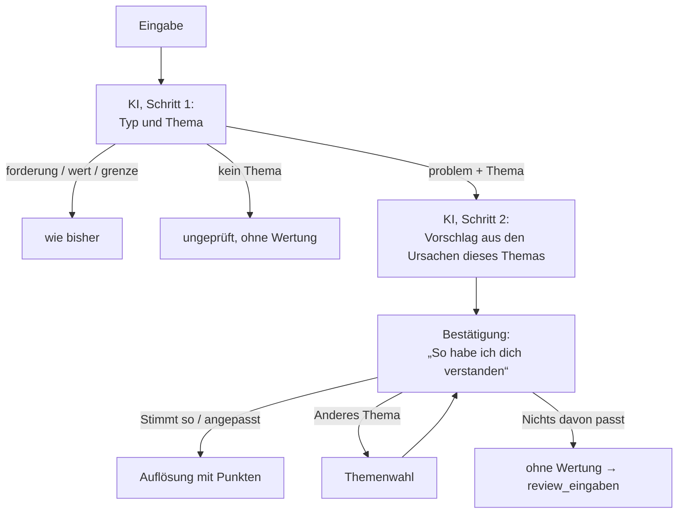

# Plan: Verlässliche Zuordnung – die KI schlägt vor, die Person bestätigt

Stand: 13. 10. 2026 · Konzept, noch nicht umgesetzt. Entscheidungen offen (siehe „Offene Entscheidungen“).

## Ziel

Wer ein persönliches Problem nennt, sieht weiterhin, welche Partei genau dafür am besten abschneidet. Neu ist: **Gewertet wird nur, was die Person als ihr Problem bestätigt hat.** Die KI versteht und schlägt vor, sie entscheidet nicht mehr allein darüber, welche Ursachen zählen.

Grundsatz: **Die KI ist Übersetzerin, die Person hat das letzte Wort.** Fehler der KI sollen klein, sichtbar und korrigierbar sein, statt unsichtbar ein Rundenergebnis zu drehen.

## Anlass

Zwei Testpartien in der geschlossenen Testphase (Persona: älterer AfD-Wähler, Rentner; AfD gegen Union mit Sachsen-Anhalt, AfD gegen SPD ohne Land; 12 Eingaben, 10 gewertete Runden). Die Punkte aus der Datenbank waren meist nachvollziehbar, die Fehler lagen fast alle in der Zuordnung:

| Falltyp | Beispiel aus den Partien | Folge |
| --- | --- | --- |
| Beleg passt nicht zur Ursache | „Bus fährt kaum“ als Beleg für „Termine im Gesundheitssystem werden kaum gesteuert“; „Polizei sieht man kaum“ für „Straftaten bleiben unaufgeklärt“; „Formulare verstehe ich nicht“ für „Register nicht vernetzt“ | Punkte für eine Ursache, die die Person nicht genannt hat |
| Falsches Thema | „Schluss mit den Windrädern“ → Auswahl aus *Schule*; die konkrete Antwort („schlafe schlecht“, Strompreis) → Auswahl aus *Hitze und Unwetter*; erst die dritte Eingabe → *Energiepreise* | Die KI ordnet nach Ähnlichkeit mit Ursachentexten, nicht nach dem Thema |
| Keine passende Ursache im Katalog | „Fremd im eigenen Ort, kaum Deutsch auf der Straße“ → nur Ursachen zu Asylverfahren und Arbeitsmarkt; die nächstliegende angetippt, gewertet | Ein anderes Problem wird gewertet als genannt |

Der Prompt regelt diese Fälle schon (`ki.ts` → `systemPrompt`: „Nimm keine Ursache dazu, nur weil sie … ähnlich klingt“), und `bereinigeAntwort` prüft, dass der Beleg wörtlich in der Schilderung steht. **Ob der Beleg die Ursache trägt, lässt sich im Code aber nicht prüfen** – und weitere Regeln im Prompt beheben einzelne Fälle, nicht das Raten selbst. Menschen schildern Symptome („Strom ist teuer“); die Ursachen im Katalog sind Befunde („Börsenpreis richtet sich nach dem teuersten Kraftwerk“). Diese Lücke kann die KI nur schließen, indem sie rät.

## Ist-Zustand

| Stelle | Verhalten heute |
| --- | --- |
| `supabase/functions/_shared/ki.ts` → `systemPrompt` | Ein Aufruf ordnet Typ, Thema, Ursachen und Belege zu. Der Prompt enthält den ganzen Katalog: 37 Themen, 161 Ursachen mit `beschreibung` und `alltag` (rund 42.000 Zeichen) – bei jedem Aufruf. |
| `ki.ts` → `bereinigeAntwort` | Übernimmt nur Ursachen mit wörtlichem, nicht doppelt verwendetem Beleg, höchstens `MAX_AUSWAHL`. Ohne Ursache: Nachfrage mit Thema (die App zeigt dann die Auswahl), nach `MAX_NACHFRAGEN = 2` ohne Wertung. |
| `src/components/Runde.tsx` → `absenden` | Liefert die KI Ursachen, geht es **ohne Bestätigung** direkt zur Auflösung (`onErgebnis`). |
| `Runde.tsx` → `auswaehlen`, `UrsachenAuswahl.tsx` | Antippen gibt es nur nach einer Nachfrage. Die Anfrage geht mit `auswahl` und leerem `verlauf` an `analyse`; die Funktion wertet ohne KI (`antwortAusAuswahl`). |
| `Ursache.alltag` (`typen.ts`) | Jede Ursache hat schon eine Fassung in der Sprache der Betroffenen; nur sie steht in der Auswahl. |
| `supabase/functions/analyse/index.ts` → `speichereRunde` | Runden ohne Wertung landen im Wortlaut in `review_eingaben` (nur Admins, 30 Tage). |
| `docs/methode.md` → „Punkte in der Runde“, „Rolle der KI“ | Beschreiben die Zuordnung durch die KI mit Belegwörtern; angetippte Ursachen „gelten als Schilderung der Person“. |

## Neuer Ablauf

### 1. Schritt 1: Typ und Thema

- Ein Aufruf mit dem Katalog **ohne Ursachen**: Themen mit Name und Beschreibung, dazu die Haltungen wie bisher. Rückgabe: `typ`, `thema_id`, `zusammenfassung`, `stichwort`, Nachfrage und Rückmeldung wie heute.
- Die Regeln für `forderung`, `wert`, `grenze` und Pauschalurteile bleiben unverändert (Grundprinzip 4, `docs/plan-haltungen.md`).
- Ist das Thema unsicher, nennt die KI bis zu zwei Kandidaten (`thema_kandidaten`); die Bestätigung bietet sie zur Wahl an.

### 2. Schritt 2: Vorschlag der Ursachen

- Ein kurzer zweiter Aufruf nur mit den Ursachen des erkannten Themas (meist 4–6, je mit `alltag`). Rückgabe: bis zu `MAX_AUSWAHL` Ursachen-IDs als **Vormarkierung** – ohne Belegwörter, sie werden nicht mehr gebraucht.
- Weil nur die Ursachen eines Themas im Blick sind, kann ein Satz wie „schlafe schlecht“ nicht mehr eine Ursache eines fremden Themas anziehen.
- Ist sich die KI nicht sicher, markiert sie nichts vor. Das ist kein Fehler: Die Person tippt dann selbst.
- Vorbild ist der zweite Aufruf für Instrumente bei Forderungen (`instrumenteZurAuswahl`, `mitInstrument`).

### 3. Bestätigung in der App

Nach der Eingabe erscheint statt der Auflösung:

> **So habe ich dich verstanden:** *Arzttermine* · [anderes Thema]
> ☑ Ich warte monatelang auf einen Facharzttermin
> ☑ Der nächste Hausarzt ist weit weg
> ☐ …
> [Stimmt so] · [Nichts davon passt]

- Angezeigt werden alle Ursachen des Themas in der `alltag`-Fassung, die vorgeschlagenen vorausgewählt. Höchstens `MAX_AUSWAHL` lassen sich wählen.
- „Stimmt so“ schickt die Auswahl wie heute über `auswahl` an `analyse` – gewertet wird ohne weiteren KI-Aufruf.
- Mehrere Probleme in einer Eingabe (Arzt und Bus in einer Schilderung): Die Bestätigung zeigt nur das Thema des Hauptproblems; über „anderes Thema“ lässt sich wechseln. Gewertet wird je Runde ein Thema, wie heute.
- Die Zeile „Deine Worte: …“ in der Auflösung entfällt; an ihre Stelle tritt „Von dir bestätigt“.
- Die bestehende Auswahl nach einer Nachfrage (`UrsachenAuswahl`) geht in dieser Bestätigung auf.

### 4. „Nichts davon passt“

- Die Runde endet ohne Wertung, wie heute nach zwei Nachfragen. Die Eingabe geht in die Review-Warteschlange `review_eingaben` (Grundprinzip 5: Wortlaut, ohne Parteien, ohne Verbindung zur Runde, 30 Tage) mit dem Vermerk, welches Thema vorgeschlagen war.
- Damit muss die App bei dieser Anfrage den `verlauf` mitschicken (heute bei `auswahl` leer).
- **So lernt der Katalog:** Aus diesen Eingaben entstehen neue `alltag`-Sätze oder neue Ursachen (Skill `/thema-erfassen`, Recherche wie bei `/thema-anlegen`). Beispiel aus der Testpartie: eine Ursache zu Alltagskontakt und gemeinsamer Sprache vor Ort beim Thema Zuwanderung und Integration.

## Was sich nicht ändert

- Punkte kommen deterministisch aus der Datenbank (`bewertung.ts`), Belege nur aus der Datenbank.
- Höchstens drei Ursachen je Runde, Gewichtung der Lösungswege, `abdeckung`, Bund und Länder.
- Forderungs- und Haltungskarte, Grenze, Pauschalurteile.
- Keine Speicherung des Wortlauts bei gewerteten Runden.

## Kosten

- Heute geht bei **jedem** Aufruf der ganze Katalog mit (rund 42.000 Zeichen, grob 11.000–13.000 Token).
- Neu: Schritt 1 mit Themen ohne Ursachen (grob ein Fünftel davon), Schritt 2 mit den Ursachen eines Themas (wenige Hundert Token).
- Zwei Aufrufe statt einem sind damit nach dieser Schätzung **deutlich günstiger** als heute. Die Bestätigung selbst kostet keinen KI-Aufruf. Vor der Umsetzung den Prompt messen (Token-Angabe in der Antwort von Mistral bei einem einzelnen Aufruf), statt der Schätzung zu vertrauen.

## Prüfung

- **Unit-Tests** (`ki.test.ts`, `logik.test.ts`): Schritt 1 und 2 bereinigen, Vormarkierung nur aus dem Thema, „Nichts davon passt“ landet in `review_eingaben`, Auswahl über `auswahl` wie bisher.
- **Mock** (`src/logic/analyse.ts`): Schritt 1 und 2 über Schlagwörter nachbilden, damit `VITE_DATENQUELLE=mock` den neuen Ablauf zeigt.
- **Kleiner Testsatz für die echte KI**: die 12 Eingaben der Testpartien plus je drei Formulierungen für „falsches Thema“ und „Beleg passt nicht“, zusammen rund 20. Erwartetes Ergebnis je Eingabe vorher festlegen und gegenlesen lassen; ein Lauf je Eingabe, wiederholt nur bei überraschendem Ergebnis. Läuft nur nach Änderungen am Prompt, lokal gegen Mistral mit `bereinigeAntwort`, **nicht** über die öffentliche Funktion (sonst füllt er `review_eingaben` und `runden`). Antworten aufzeichnen, damit Änderungen an der Bereinigung ohne neuen Aufruf geprüft werden können. Format wie `docs/prompt-evaluation.md`.
- Weil die Bestätigung Fehler abfängt, muss der Test zeigen, dass die KI **meist** richtig vorschlägt – nicht immer.

## Risiken

| Risiko | Einschätzung und Gegenmittel |
| --- | --- |
| Ein Klick mehr pro Runde, weniger „magisch“ | Bei richtigem Vorschlag genügt ein Tipp. Die Bestätigung zeigt zugleich, dass das Spiel zugehört hat. |
| Taktische Auswahl: Ursachen antippen, bei denen die eigene Partei gut abschneidet | Schon heute über die Wortwahl möglich. Die Auswahl zeigt keine Parteien und keine Punkte; der Themenhinweis verrät vor der Auflösung nichts über einzelne Parteien. Gering, nicht null. |
| Personen bestätigen ungelesen den Vorschlag | Dann gilt im schlechtesten Fall der heutige Stand. Vorschläge nur bei Sicherheit, sonst ohne Vormarkierung. |
| Mehr Runden ohne Wertung durch „Nichts davon passt“ | Erwünscht: Sie zeigen die Lücken im Katalog statt sie mit falschen Punkten zu überdecken. Anteil in der Admin-Ansicht beobachten. |

## Offene Entscheidungen

1. **Bestätigung immer oder nur bei Unsicherheit?** Vorschlag: immer – einheitlicher Ablauf, und nur so gilt Grundprinzip 2 ohne Ausnahme.
2. **Zweiter Aufruf oder keine Vormarkierung?** Ohne Schritt 2 wäre es noch günstiger, die Person müsste aber immer selbst tippen. Vorschlag: Schritt 2 behalten, bei Fehler oder Zeitüberschreitung ohne Vormarkierung weiter.
3. **„Nichts davon passt“ immer anbieten?** Vorschlag: ja.
4. **Bestätigungstext** („So habe ich dich verstanden“) und Darstellung mit der Gestaltung abstimmen (Quizshow-Anmutung, `/ux-copy`).

## Änderungen an Dokumenten

- `docs/methode.md` → „Punkte in der Runde“, Punkt 2: Zuordnung durch die KI als Vorschlag, gewertet wird die Bestätigung; Belegwörter entfallen; „Nichts davon passt“ ergänzen.
- `docs/methode.md` → „Rolle der KI“: Tabelle anpassen („schlägt Thema und Ursachen vor“), Hinweis auf zwei Schritte.
- `docs/konzept.md` (Spielablauf, KI-Schnittstelle) und `docs/datenmodell.md` (Vermerk des vorgeschlagenen Themas in `review_eingaben`, falls neue Spalte).
- `CLAUDE.md` → „Kurzfassung, Runde“: Bestätigung erwähnen.

## Reihenfolge

1. Entscheidungen oben treffen; Prompt messen (Kosten).
2. Schritt 1 und 2 in `ki.ts` und `analyse/index.ts`, mit Unit-Tests und Mock. Antwortformat abwärtskompatibel halten, bis die App umgestellt ist.
3. Bestätigung in der App (`Runde.tsx`, `UrsachenAuswahl.tsx`, `Aufloesung.tsx`), „Nichts davon passt“ mit Speicherung.
4. Testsatz einmal vorher (heutiger Stand) und einmal nachher laufen lassen.
5. `docs/methode.md` und die übrigen Dokumente anpassen.
6. Katalog aus „Nichts davon passt“ ergänzen – laufend, über die bestehenden Skills.
